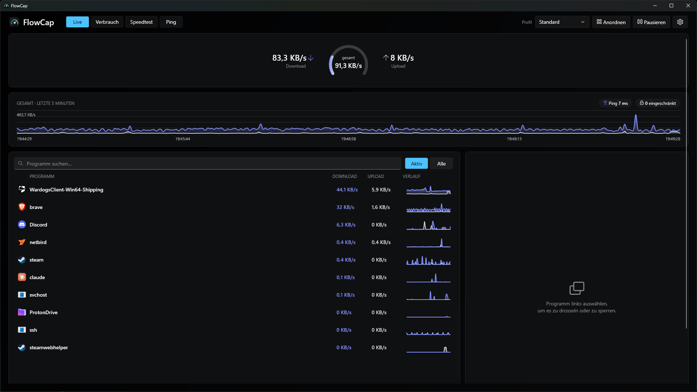
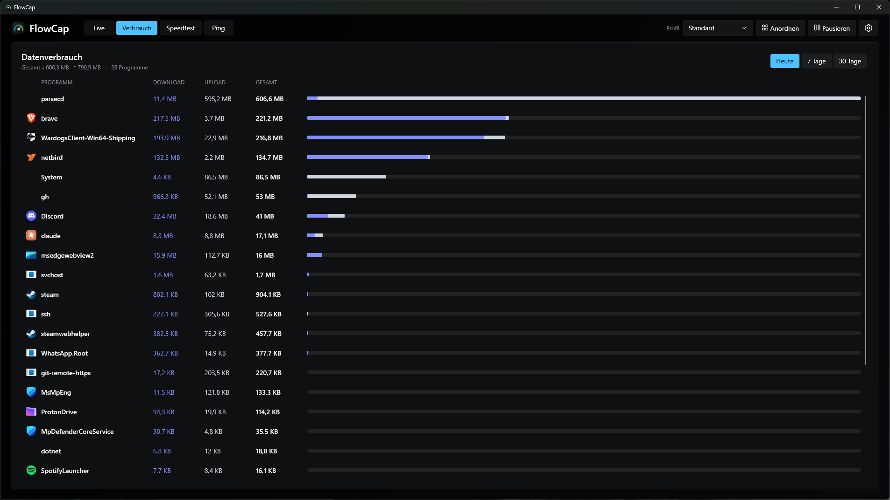
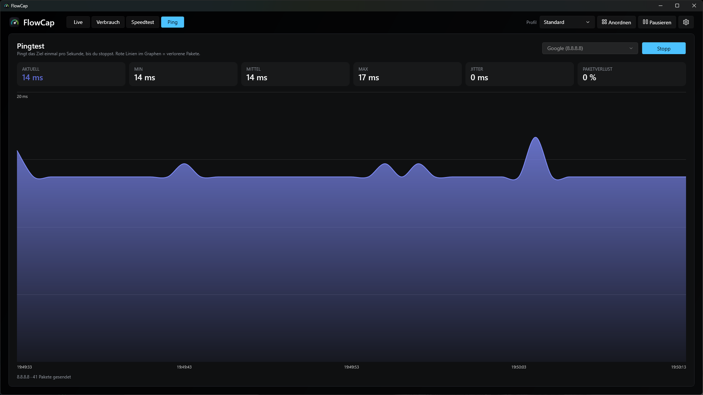
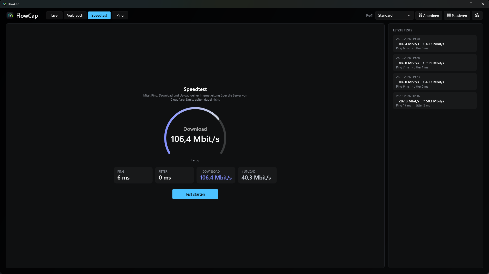
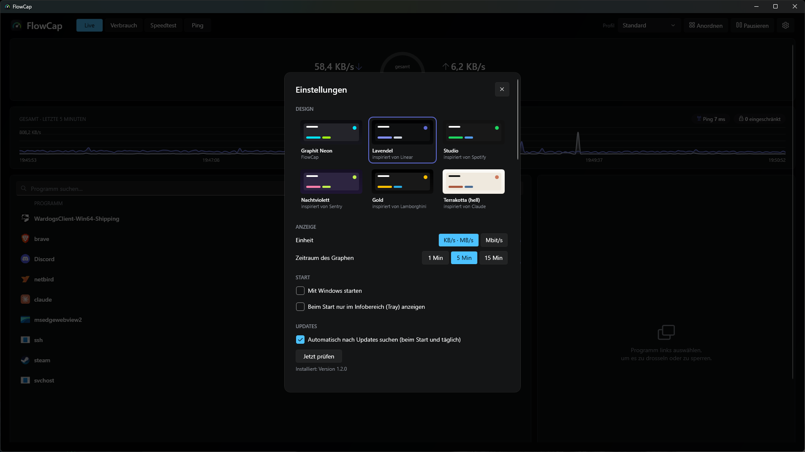

# FlowCap

Bandbreite pro Programm unter Windows steuern: alle laufenden Programme mit Live-Download/-Upload sehen, einzeln drosseln oder sperren, über einen Proxy oder einen WireGuard-VPN leiten – nur dieses eine Programm, alles andere bleibt direkt.



| Datenverbrauch | Pingtest |
|---|---|
|  |  |
| **Speedtest** | **Einstellungen** |
|  |  |

Neu erstellen: FlowCap öffnen, dann in einer Administrator-PowerShell `tools\screenshots.ps1` ausführen.

## Funktionen

- **Live-Dashboard** – Verlaufsgraph, Tacho, Liste aller Programme mit Mini-Verlauf, Ping-Anzeige; Module frei anordnen und in der Größe ändern
- **Limits pro Programm** – Download/Upload per Schieberegler, Internet sperren, Gesamtlimit für alle Programme
- **Spielmodus** – läuft ein Programm mit Vorrang, teilen sich alle anderen ein Limit
- **Profile & Zeitpläne** – z. B. „Arbeit“ Mo–Fr 9–17 Uhr automatisch
- **Datenverbrauch** – pro Programm und Tag/Woche/Monat, Datenlimits mit Warnung und automatischer Sperre
- **Verbindungen & Firewall** – offene TCP-Verbindungen eines Programms mit Hostname, Land und Flagge; einzelne Ziel-Adressen pro Programm sperren
- **Upload-Warnung** – Meldung, wenn ein Programm in 10 Minuten mehr als 100 MB bis 1 GB hochlädt (Schwelle einstellbar, pro Programm abschaltbar)
- **Proxy pro Programm** – SOCKS5 oder HTTP-CONNECT, auch für Programme ohne Proxy-Unterstützung
- **VPN pro Programm (WireGuard)** – `.conf` laden, Programm zuweisen; TCP und UDP über IPv4 und IPv6 laufen durch den Tunnel, mit Kill-Switch; optional DNS über den Tunnel
- **Speedtest** – Ping, Jitter, Download und Upload (über Cloudflare)
- **Pingtest** – Dauerping zu wählbarem Ziel mit Verlauf, Min/Mittel/Max, Jitter und Paketverlust; dazu ein Ping-Verlauf über 24 Stunden, 7 und 30 Tage
- **Automatische Updates** – über die GitHub-Releases, Installation mit einem Klick
- **Tray-Schnellmenü, Benachrichtigungen, Autostart**

## Voraussetzungen

- Windows 10/11, 64 Bit
- Administratorrechte (der Netzwerktreiber WinDivert lässt sich nur so öffnen)

## Bauen

Benötigt das [.NET 10 SDK](https://dotnet.microsoft.com/) und für den Installer [Inno Setup 6](https://jrsoftware.org/isinfo.php).

```powershell
.\build.ps1
```

Führt die Tests aus, veröffentlicht eine eigenständige Version nach `publish\` und baut den Installer nach `dist\FlowCap-Setup-<Version>.exe`.

Nur Tests: `dotnet test SpeedLimit.slnx`

## Aufbau

| Pfad | Inhalt |
|---|---|
| `SpeedLimit/` | WPF-Anwendung (Projektname historisch, die App heißt FlowCap) |
| `SpeedLimit/Throttler.cs` | Paketerfassung per WinDivert, Drosselung, Sperren, Proxy-/VPN-Weiche |
| `SpeedLimit/WireGuard*.cs` | eigene WireGuard-Implementierung (Handshake, Verschlüsselung, Timer, Config) |
| `SpeedLimit/ProxyRelay.cs`, `Proxy.cs` | lokales Relay und SOCKS5/HTTP-Anmeldung für „Proxy pro Programm“ |
| `SpeedLimit.Tests/` | xUnit-Tests |
| `installer/FlowCap.iss` | Inno-Setup-Skript |
| `tools/socks5-testproxy.py` | kleiner protokollierender SOCKS5-Proxy zum Testen |

## Datenschutz & Sicherheit

- Einstellungen, Verbrauchsdaten und Ping-Verlauf (30 Tage) liegen lokal unter `%AppData%\FlowCap`.
- Länder zu IP-Adressen kommen aus einer mitgelieferten Offline-Datenbank – es werden keine Adressen an einen Dienst geschickt.
- Proxy-Passwörter und WireGuard-Configs (inkl. privatem Schlüssel) werden mit Windows-DPAPI verschlüsselt gespeichert.
- FlowCap sendet keine Telemetrie. Eigene Netzwerkanfragen gehen nur an:
  - deine Proxys und VPN-Server,
  - Cloudflare (Ping-Anzeige und Speedtest),
  - das Ziel, das du im Pingtest einträgst (Standard: Cloudflare 1.1.1.1),
  - GitHub (`api.github.com` und `github.com`) für die Update-Prüfung beim Start und einmal täglich – abschaltbar unter Einstellungen → Updates,
  - deinen DNS-Server (bzw. bei „DNS über Tunnel“ den DNS-Server deines VPN), um Hostnamen in der Verbindungsliste aufzulösen.
- Updates werden nur aus den Releases von `github.com/Xieonie/FlowCap` geladen und vor der Installation mit der SHA-256-Prüfsumme von GitHub verglichen.

## Bekannte Grenzen

- DNS: Windows löst Namen zentral für alle Programme auf, deshalb lässt sich DNS nicht pro Programm umleiten.
  - VPN mit „DNS über Tunnel“ (Standard): alle DNS-Anfragen von Windows gehen über den DNS-Server des VPN, solange der Tunnel verbunden ist – auch die anderer Programme. Ist er getrennt, wird wieder der normale DNS genutzt. DNS über IPv6 läuft weiterhin direkt.
  - Proxy: DNS läuft über den normalen Anschluss.
- Proxy: nur TCP über IPv4; UDP und IPv6 werden für zugewiesene Programme gesperrt.
- VPN: IPv6 nur, wenn die Config eine IPv6-Adresse hat (sonst wird IPv6 der zugewiesenen Programme gesperrt); die Verbindung zum VPN-Server selbst läuft über IPv4. Bandbreiten-Limits gelten nicht für VPN-Verkehr.
- Firewall pro Ziel: gesperrt wird eine IP-Adresse, nicht ein Hostname – Dienste mit vielen wechselnden Adressen können über eine andere Adresse weiterlaufen.
- Länder-Datenbank: Stand des jeweiligen FlowCap-Release (DB-IP, monatlich aktualisiert).
- Zuordnung erfolgt über den Programmnamen – einzelne Windows-Dienste in `svchost` lassen sich nicht trennen.
- Exe und Installer sind nicht signiert (SmartScreen-Warnung „Unbekannter Herausgeber“). Virenscanner stufen WinDivert teils als „potenziell unerwünscht“ ein.

## Lizenz

MIT – siehe [LICENSE](LICENSE). Fremd-Komponenten: [THIRD-PARTY-NOTICES.md](THIRD-PARTY-NOTICES.md).
